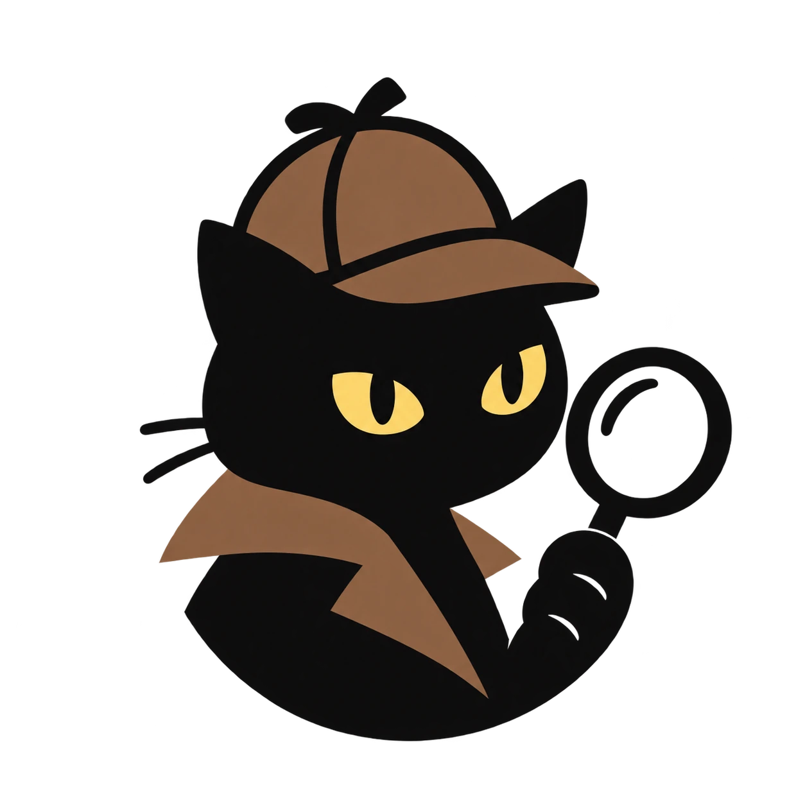
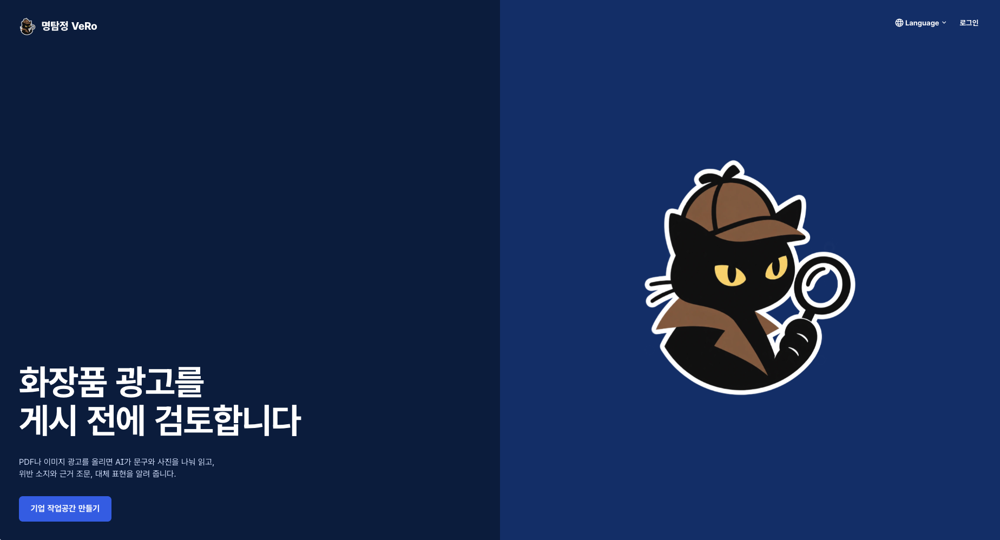
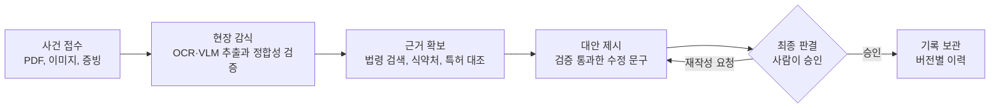
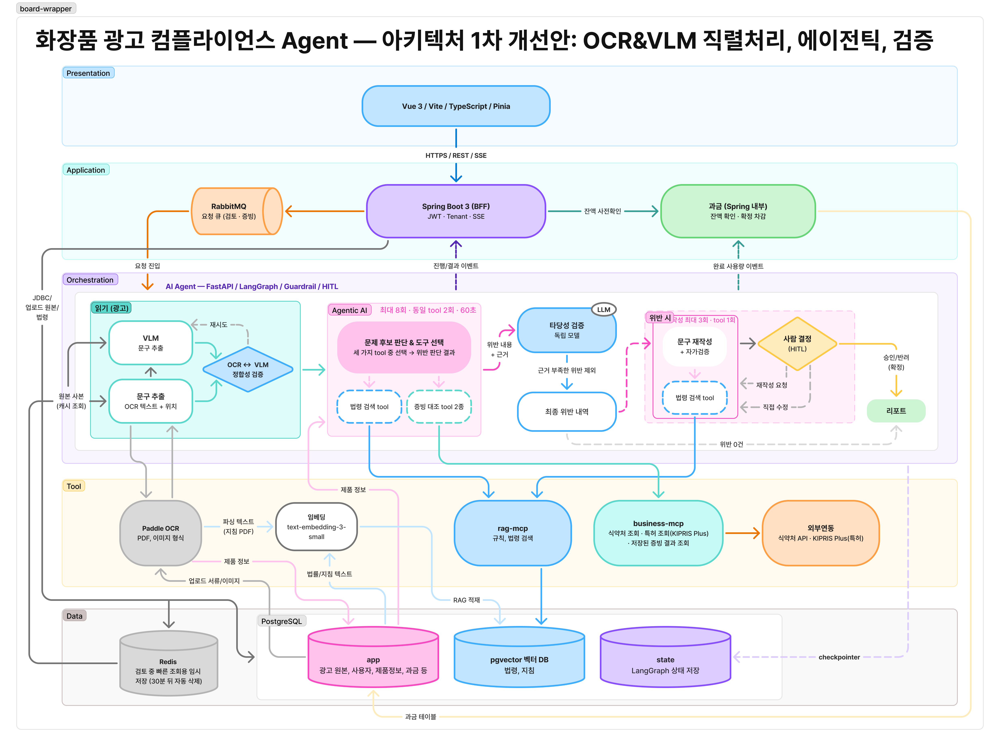
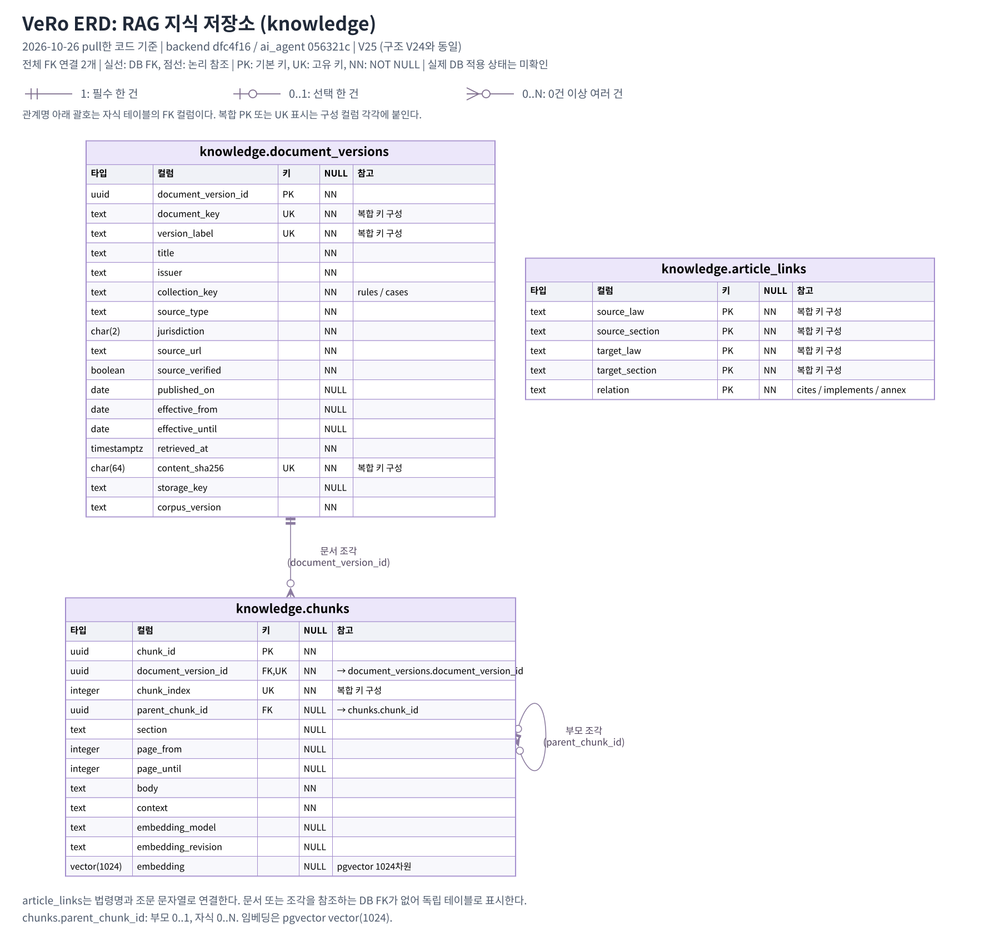
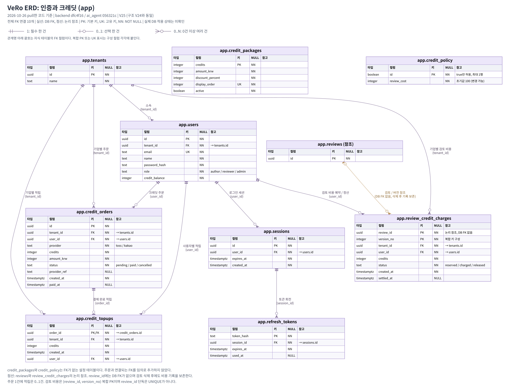
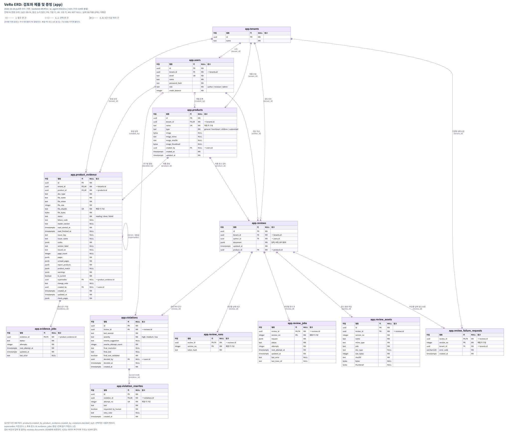

# 명탐정 VeRo

**화장품 광고, 올리기 전에 먼저 수사합니다.**

광고 파일을 올리면 AI Agent가 위반 소지 문구를 찾아 
근거 조문과 고쳐 쓴 문구를 함께 내놓습니다. 최종 판단은 사람이 합니다.

 

 

 

## 사건 개요

> [!IMPORTANT]
> 식약처 화장품 행정처분 **427건 중 324건(76%)** 이 표시광고 위반입니다.

협회 광고자문이 있지만 캠페인 일정에 맞춰 쓰기에는 걸림돌이 많습니다. VeRo는 자문을 대체하지 않고, **게시 전에 브랜드와 대행사가 직접, 바로 돌려 보는 사전검토**를 맡습니다.

| 막히는 지점                 | 지금 벌어지는 일                                                              |
| --------------------------- | ----------------------------------------------------------------------------- |
| **기다릴 수 없는 리드타임** | 자문 결과까지 5일에서 3주. 빠른 처리 경로가 없습니다.                         |
| **한 번 반려되면 끝**       | 부적합이면 재자문이 어려워, 자신 없으면 신청을 건너뛰고 게시합니다.           |
| **법무 지식의 공백**        | 마케터는 위반을 스스로 판단하기 어렵고, 법무는 모든 문구를 손으로 대조합니다. |
| **증빙과 주장의 어긋남**    | 미백만 보고된 제품이 주름 개선을 말해도 게시 전에 잡을 장치가 없습니다.       |
| **승인 절차의 생략**        | 일정에 쫓겨 내부 승인 없이 먼저 게시합니다.                                   |

 

## 수사 과정

| 단계          | 하는 일                                                                                                         |
| ------------- | --------------------------------------------------------------------------------------------------------------- |
| **사건 접수** | 상세페이지 PDF나 광고 이미지, 시험성적서 같은 증빙을 올리면 바로 접수하고, 진행 상황은 SSE로 실시간 전달합니다. |
| **현장 감식** | OCR로 문구와 위치를 추출하고 VLM 결과와 정합성을 검증해 "7일 만에 주름 개선", "아토피 치료" 같은 표현을 찾습니다. |
| **근거 확보** | 화장품법과 관련 고시에서 근거 조문을 찾고, 식약처 기능성 보고와 특허 등록을 공공 API로 대조합니다.              |
| **대안 제시** | 규칙 검사와 모델 검증을 모두 통과한 수정 문구만 제안합니다.                                                     |
| **최종 판결** | 담당자가 문구마다 원문 유지, 수정안 채택, 직접 수정을 고릅니다. 재작성한 문구는 다시 검증합니다.                 |
| **기록 보관** | 판정, 근거, 문구별 결정과 재작성 이력을 남기고, 광고를 고치면 새 버전으로 다시 검토합니다.                       |

> [!NOTE]
> AI 결과는 내부 검토 초안입니다. 협회 자문이나 정부 인증을 대체하지 않으며 그를 보완하기 위한 서비스임을 알립니다.

 

## 시스템 아키텍처

OCR·VLM 직렬 처리와 정합성 검증 → Agent 도구 선택 → 독립 모델의 타당성 검증 → 문구 재작성과 사람의 결정으로 이어지는 **1차 개선안**입니다. 과금은 Spring 내부에서 처리하고, 업무·지식·Agent 상태는 PostgreSQL 안에서 구분합니다.

<b>계층별로 자세히 보기</b>

 

| 계층              | 맡는 일                                                                                                                                                                                                                |
| ----------------- | ---------------------------------------------------------------------------------------------------------------------------------------------------------------------------------------------------------------------- |
| **Presentation**  | Vue 화면은 Spring API만 부릅니다. 모델 키와 DB 정보는 브라우저에 오지 않습니다.                                                                                                                                        |
| **Application**   | Spring Boot BFF가 JWT 인증, 기업 격리, SSE와 요청 접수를 맡습니다. 검토·증빙 요청은 DB outbox와 RabbitMQ로 전달합니다. Spring 내부 과금 모듈은 잔액을 사전 확인하고 사용량에 따라 차감을 확정합니다. |
| **Orchestration** | OCR·VLM 정합성 검증 뒤 Agent가 법령 검색과 증빙 대조 도구를 선택합니다. 도구 선택은 최대 8회·동일 도구 연속 2회·60초로 제한합니다. 독립 모델이 근거가 부족한 위반 후보를 제외하고, 남은 위반은 문구 재작성·자가검증과 HITL로 이어집니다. 재작성은 최대 3회이며, 회당 법령 검색 도구 호출은 1회로 제한합니다. |
| **Tool**          | PaddleOCR가 PDF·이미지의 문구와 위치를 추출합니다. `text-embedding-3-small`로 법령·지침을 임베딩하고, `rag-mcp`가 검색합니다. `business-mcp`는 저장된 증빙 결과와 식약처·KIPRIS Plus 조회를 제공합니다. |
| **Data**          | PostgreSQL의 `app`은 광고 원본·사용자·제품·증빙·크레딧을, `knowledge`는 법령·지침과 pgvector 벡터를 저장합니다. Agent 체크포인트는 별도로 관리합니다. 도표의 `state`는 이 상태 저장 영역을 뜻합니다. Redis는 처리 중 원본을 임시 보관하며 TTL은 30분입니다. |

 

## ERD

### RAG 지식 저장소 · knowledge

문서 버전과 청크, 청크의 부모·자식 관계를 저장합니다. 임베딩은 pgvector `vector(1024)`를 사용합니다. `article_links`는 법령명과 조문 문자열로 연결하며 문서·청크에 대한 DB FK는 없습니다.

### 인증과 크레딧 · app

기업과 사용자, 로그인 세션, 크레딧 구매·적립·검토별 차감을 관리합니다. `review_credit_charges.review_id`는 검토 삭제 후에도 과금 기록을 보존하기 위해 DB FK로 연결하지 않습니다.

### 검토와 제품 및 증빙 · app

제품과 시험성적서 등 증빙, 광고 검토, 비동기 작업, 문구별 결정과 재작성 이력을 관리합니다. 버전별 입력과 분석 결과는 `reviews.document` JSONB에 저장합니다. 검토 전체 승인 컬럼은 V24에서 제거됐으며, 문구별 결정은 `violations`에 유지됩니다.

실선은 DB FK, 점선은 논리 참조입니다. `PK`는 기본 키, `UK`는 고유 키, `NN`은 NOT NULL이며, 복합 키 표시는 구성 컬럼 각각에 붙습니다. Agent 라이브러리가 관리하는 체크포인트 테이블은 이 ERD에서 제외했습니다. 아키텍처는 개선 설계, ERD는 소스 코드 기준이며 실제 DB 적용 상태는 별도로 확인해야 합니다.

 

## 저장소

| 저장소 | 맡는 일 | 주요 기술 |
| --- | --- | --- |
| [**frontend**](https://github.com/SKALA-AI-Agent-Capstone/frontend) | 랜딩, 로그인, 광고 업로드와 진행 화면, 문구별 결정과 승인, 크레딧 결제, 한국어와 영어 | Vue 3, Vite, Pinia |
| [**backend**](https://github.com/SKALA-AI-Agent-Capstone/backend) | 인증과 기업 격리, 검토 이력과 버전, 작업 큐, SSE 중계, 크레딧, 결정 저장 | Java 21, Spring Boot 3, RabbitMQ |
| [**ai_agent**](https://github.com/SKALA-AI-Agent-Capstone/ai_agent) | LangGraph Agent, rag-mcp, business-mcp, 평가셋 | Python, FastAPI, LangGraph, FastMCP |

 

## 기술 스택

| 영역 | 기술 | 적용 범위 |
| :---: | --- | --- |
| **Web** | &nbsp;&nbsp;&nbsp;&nbsp;&nbsp;&nbsp; | 화면, 상태 관리, 다국어 |
| **Server** | &nbsp;&nbsp;&nbsp;&nbsp;&nbsp;&nbsp; | REST API, 인증과 권한, DB 마이그레이션 |
| **Messaging** | &nbsp;&nbsp; | 작업 큐, 재시도와 DLQ, 진행 이벤트 |
| **AI Agent** | &nbsp;&nbsp;&nbsp;&nbsp;&nbsp;&nbsp; | 분석 그래프, 도구 선택, HITL 재개 |
| **MCP** | &nbsp;&nbsp; | 법령 검색, 증빙과 공공 API 조회 |
| **Data** | &nbsp;&nbsp;&nbsp;&nbsp; | 업무 데이터, Agent 상태, 법령 벡터 검색, 원본 임시 보관 |
| **Ops** | &nbsp;&nbsp;&nbsp;&nbsp;&nbsp;&nbsp; | 로컬 실행, 배포, 실행 추적 |
| **외부 연동** | &nbsp;&nbsp;&nbsp;&nbsp; | 기능성 보고 조회, 특허 조회, 테스트 결제 |

 

## 수사팀

<table>
  <tr>
    <td align="center" width="16%"><a href="https://github.com/naneunmina"> <b>김민아</b></a> Agent</td>
    <td align="center" width="16%"><a href="https://github.com/S-Gihun"> <b>손기훈</b></a> FE · BE</td>
    <td align="center" width="16%"><a href="https://github.com/YunhuiHwang"> <b>황윤희</b></a> Agent · Harness</td>
    <td align="center" width="16%"><a href="https://github.com/kyeonghyunLee"> <b>이경현</b></a> BE</td>
    <td align="center" width="16%"><a href="https://github.com/uemy6unoh"> <b>김영환</b></a> RAG · Agent</td>
    <td align="center" width="16%"><a href="https://github.com/largeredjade"> <b>이홍규</b></a> DB · RAG</td>
  </tr>
</table>

 

 
<i>모든 광고에는 단서가 남는다.</i>

